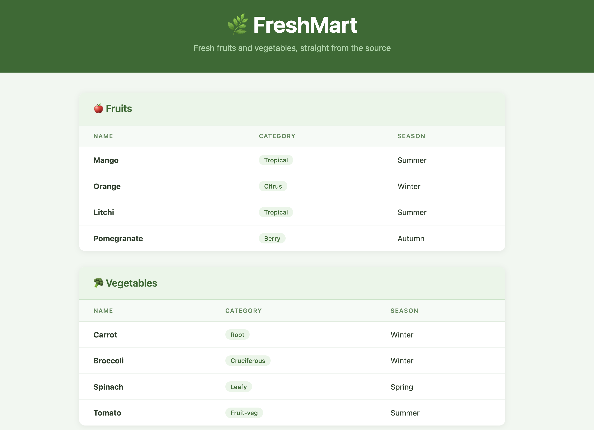
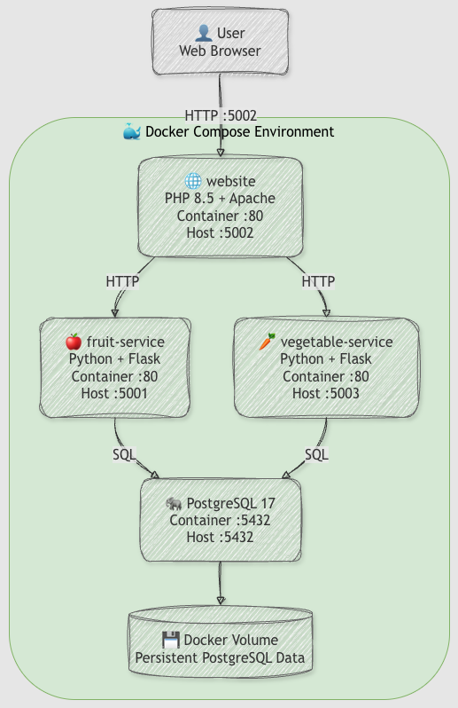

# 🌿 FreshMart


> A containerized microservices application built with Flask, PHP and PostgreSQL. It uses Docker Compose for local development, Kubernetes for orchestration, and GitHub Actions for automated testing and image publishing.

## 🌐 Deployment

FreshMart was previously deployed on Render using its free tier.

**Previous deployment:** https://freshmart-website-wlo8.onrender.com/

The frontend is still accessible, but the free-tier backend services are no longer active. Consequently, the live page currently displays service-unavailable messages for the fruit and vegetable services.

The complete application remains reproducible locally using Docker Compose or Kubernetes. See the instructions below.

---

## 📸 Preview



---

## 🏗️ Architecture

FreshMart consists of a PHP frontend, two independent Flask REST APIs, and a PostgreSQL database.

The application is containerized with Docker and can be deployed using either Docker Compose or Kubernetes. It was also previously deployed on Render.



### Services

| Service | Technology | Role | Compose host port | Container port |
|---|---|---|---:|---:|
| `website` | PHP 8.5 + Apache | Frontend | 5002 | 80 |
| `fruit-service` | Python + Flask | Fruit REST API | 5001 | 80 |
| `vegetable-service` | Python + Flask | Vegetable REST API | 5003 | 80 |
| `db` | PostgreSQL 17 | Database | 5432 | 5432 |

> Each application container listens on port `80` internally. Docker Compose maps these ports to different host ports. In Kubernetes, the APIs and database are accessible internally through ClusterIP Services, while the frontend is exposed through a NodePort Service.

---

## 📁 Project Structure

```text
FreshMartApp/
├── .github/
│   └── workflows/
│       └── ci.yml
├── db/
│   ├── 01-schema.sql
│   ├── 02-fruits.sql
│   └── 03-vegetables.sql
├── k8s/
│   ├── 00-namespace.yaml
│   ├── configmap.yaml
│   ├── secrets.yaml
│   ├── postgres-pvc.yaml
│   ├── db-init-configmap.yaml
│   ├── db-deployment.yaml
│   ├── product-deployment.yaml
│   ├── vegetable-deployment.yaml
│   └── frontend-deployment.yaml
├── product/
│   ├── Dockerfile
│   ├── api.py
│   └── requirements.txt
├── vegetable/
│   ├── Dockerfile
│   ├── api.py
│   └── requirements.txt
├── website/
│   ├── Dockerfile
│   └── index.php
├── screenshots/
├── docker-compose.yml
└── README.md
```

---

## 🚀 Run Locally with Docker Compose

### Prerequisites

- Docker Desktop
- Git

### 1. Clone the repository

```bash
git clone https://github.com/FireAMS/FreshMartApp.git
cd FreshMartApp
```

### 2. Build and start the application

```bash
docker compose up --build
```

### 3. Access the services

| Service | URL |
|---|---|
| 🌿 Website | http://localhost:5002 |
| 🍎 Fruit API | http://localhost:5001/ |
| 🥕 Vegetable API | http://localhost:5003/vegetables |

### 4. Stop the application

```bash
docker compose down
```

PostgreSQL is initialized using the SQL scripts in `db/` during the first database startup. Database data is persisted in a Docker volume.

---

## ☸️ Run on Kubernetes (Local)

The Kubernetes manifests in `k8s/` deploy the complete application into a dedicated `freshmart` namespace.


### Prerequisites

- Docker Desktop with Kubernetes enabled, or a local cluster using kind or Minikube
- `kubectl`

### 1. Deploy the application

```bash
kubectl apply -f k8s/
```

### 2. Monitor the pods

```bash
kubectl get pods -n freshmart -w
```

Wait until the application pods are ready.

### 3. Access the frontend

```bash
kubectl port-forward -n freshmart svc/frontend-service 8080:80
```

Open:

http://localhost:8080

> The frontend Service uses NodePort `30500` for external exposure. For local development, port-forwarding provides a convenient way to access the application. NodePort accessibility depends on the local Kubernetes environment. The APIs and database remain internal to the cluster.

### 4. Clean up

```bash
kubectl delete namespace freshmart
```

This removes the FreshMart Kubernetes resources, including the PersistentVolumeClaim. Whether the underlying persistent storage is also deleted depends on the cluster's PersistentVolume reclaim policy.


---

## ⚙️ CI/CD

GitHub Actions automates the testing and image publishing process on pushes and pull requests targeting `master`.

The pipeline consists of three jobs:

1. **Docker Compose CI:** Builds the application containers, starts the services, and tests the fruit and vegetable APIs using `curl`.
2. **Kubernetes Integration Tests:** Builds the application images, creates a temporary Kubernetes cluster using [kind](https://kind.sigs.k8s.io/), deploys the Kubernetes manifests, waits for the deployments to become available, and tests the APIs and frontend through Kubernetes Services.
3. **Docker Hub Publishing:** After successful tests, builds multi-architecture images (`linux/amd64` and `linux/arm64`) and publishes them to Docker Hub with `latest` and commit SHA tags. This job runs on pushes to `master`.

### CI/CD Pipeline

```text
       Git Push / Pull Request
                 │
                 ▼
          GitHub Actions
                 │
                 ▼
         Docker Compose CI
                 │
          ┌──────┴──────┐
          │             │
         Pass          Fail
          │             │
          ▼             ▼
    Kubernetes       Stop
   Integration Tests
          │
     ┌────┴────┐
     │         │
    Pass      Fail
     │         │
     ▼         ▼
 Docker Hub   Stop
 Publishing
 (master push)
```

### Previous Render Deployment

The application was previously deployed on [Render](https://render.com/).

| Component | Technology | Platform |
|---|---|---|
| Frontend | PHP 8.5 + Apache | Render |
| Fruit API | Flask | Render |
| Vegetable API | Flask | Render |
| Database | PostgreSQL 17 | Render |

Database credentials were configured through environment variables rather than stored in the repository.

The Render deployment is no longer active as a complete application because the free-tier services have expired.

---

## 🐳 Docker Hub Images

The application images are published to Docker Hub:

- [Fruit Service](https://hub.docker.com/r/fireams/fruit-service)
- [Vegetable Service](https://hub.docker.com/r/fireams/vegetable-service)
- [Website](https://hub.docker.com/r/fireams/freshmart-website)

---

## 🔮 Next Steps

- Implement secure secrets management using AWS Secrets Manager.
- Add Kubernetes Ingress, Horizontal Pod Autoscaling (HPA), and NetworkPolicies.
- Introduce Infrastructure as Code using Terraform.
- Explore deployment on AWS using Amazon EKS, ECR, and RDS.
- Implement monitoring and logging with Amazon CloudWatch.
- Develop Python automation scripts for deployment verification and operational tasks.

---

## 👩‍💻 Author

**Audrey**

- [GitHub @FireAMS](https://github.com/FireAMS)

---

*FreshMart — Flask • PHP • PostgreSQL • Docker • Kubernetes • GitHub Actions*